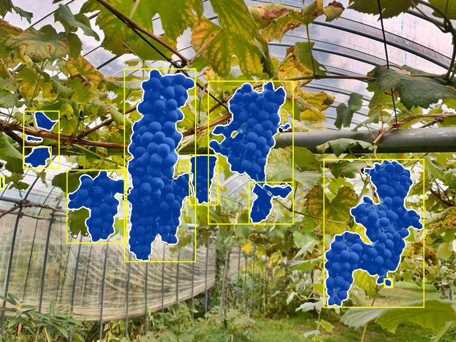

# Inferencia: cómo usar el pipeline

El pipeline recibe una imagen y devuelve una máscara y una caja por racimo de uva:

1. Florence-2 (`base`, *beam search* con 3 haces) detecta cajas con la frase `grapes` sobre la imagen completa.
2. Se descartan las cajas de grupo (las que contienen dos o más cajas).
3. SAM (`vit_h`) segmenta cada caja.
4. Se eliminan máscaras duplicadas con NMS de máscara.



## Requisitos

Entorno instalado (`pip install -r requirements.txt`) y los checkpoints de SAM en
`data/checkpoints/`:

```bash
wget -P data/checkpoints https://dl.fbaipublicfiles.com/segment_anything/sam_vit_h_4b8939.pth   # 2,4 GB
wget -P data/checkpoints https://dl.fbaipublicfiles.com/segment_anything/sam_vit_b_01ec64.pth   # 360 MB, opcional
```

Florence-2 se descarga solo de Hugging Face la primera vez. Con GPU usa CUDA
automáticamente; `vit_h` entra en 8 GB de memoria.

Todos los comandos se corren desde la raíz del repositorio.

## Desde la consola

```bash
python scripts/predict.py data/Uvas1.jpg data/Uvas2.jpg --overlay
```

```
Uvas1.jpg: 11 cajas de Florence-2, 0 de grupo descartadas, 10 mascaras -> outputs/predict/Uvas1.json
Uvas2.jpg: 17 cajas de Florence-2, 5 de grupo descartadas, 11 mascaras -> outputs/predict/Uvas2.json
```

Por cada imagen se guarda:

- `outputs/predict/<nombre>.json`: cajas y máscaras (ver "Formato de salida").
- `outputs/predict/<nombre>_overlay.png`: solo con `--overlay`; la imagen con las
  máscaras en azul y sus cajas en amarillo.

Los modelos se cargan una sola vez, así que conviene pasar todas las imágenes en
un mismo comando.

| Opción | Valor por defecto | Qué hace |
|---|---|---|
| `--out-dir` | `outputs/predict` | carpeta de salida |
| `--overlay` | no | guarda también la imagen con máscaras y cajas |
| `--sam-model` | `vit_h` | `vit_h` o `vit_b` (más rápido, máscaras algo peores) |
| `--florence-size` | `base` | `base` o `large` |
| `--phrase` | `grapes` | frase que recibe Florence-2 |
| `--num-beams` | `3` | haces de *beam search*; 1 es decodificación greedy |
| `--keep-group-boxes` | no | no descarta las cajas de grupo |

## Desde Python

`src/` tiene que estar en el path (los notebooks y el script lo agregan con `sys.path`).

```python
import sys
sys.path.append("src")

from PIL import Image
from grape_autoseg.pipeline.inference import GrapePipeline, PipelineConfig

pipeline = GrapePipeline()  # carga Florence-2 y SAM; hacerlo una sola vez

prediction = pipeline.predict(Image.open("data/Uvas1.jpg"))

len(prediction.masks)        # cantidad de racimos
prediction.masks             # (N, H, W) booleanas, a resolución completa
prediction.boxes_xyxy        # (N, 4): x1, y1, x2, y2 de la caja ajustada a cada máscara
prediction.scores            # (N,): calidad de cada máscara según SAM
prediction.florence_boxes    # todas las cajas de Florence-2, antes de filtrar
prediction.group_box_idx     # índices de las cajas de grupo descartadas
```

Para cambiar la configuración:

```python
pipeline = GrapePipeline(PipelineConfig(sam_model="vit_b", num_beams=1, drop_group_boxes=False))
```

Para guardar el resultado:

```python
import json

with open("prediccion.json", "w") as f:
    json.dump(prediction.to_coco(file_name="Uvas1.jpg"), f)
```

## Formato de salida

Formato COCO, con una anotación por racimo:

```json
{
  "image": {"file_name": "Uvas1.jpg", "width": 1200, "height": 900},
  "categories": [{"id": 1, "name": "grape_cluster"}],
  "annotations": [
    {
      "id": 1,
      "category_id": 1,
      "bbox": [851.0, 418.0, 265.0, 391.0],
      "area": 50701,
      "score": 0.968,
      "segmentation": {"size": [900, 1200], "counts": "Sd\\g09ik05SOL..."}
    }
  ],
  "config": {"florence_size": "base", "phrase": "grapes", "num_beams": 3, "sam_model": "vit_h", "drop_group_boxes": true}
}
```

| Campo | Significado |
|---|---|
| `bbox` | `[x, y, ancho, alto]` en píxeles, con origen arriba a la izquierda. Es la caja ajustada a la máscara, no la de Florence-2. |
| `segmentation` | máscara en RLE comprimido de COCO; `size` es `[alto, ancho]`. |
| `area` | cantidad de píxeles de la máscara. |
| `score` | calidad que SAM le estima a la máscara (0 a 1). No es una confianza de detección: Florence-2 no da ninguna. |
| `config` | configuración con la que se generó la predicción. |

## Leer un resultado guardado

```python
import json
import sys
sys.path.append("src")

from grape_autoseg.pipeline.coco import rle_to_mask

result = json.load(open("outputs/predict/Uvas1.json"))

for annotation in result["annotations"]:
    mask = rle_to_mask(annotation["segmentation"])  # (H, W) booleana
    x, y, w, h = annotation["bbox"]
    print(annotation["id"], mask.shape, annotation["area"], round(annotation["score"], 2))
```

Sin este repositorio, la máscara se decodifica directamente con `pycocotools`:

```python
from pycocotools import mask as mask_utils

seg = annotation["segmentation"]
mask = mask_utils.decode({"size": seg["size"], "counts": seg["counts"].encode("ascii")}).astype(bool)
```

## Limitaciones

- Racimos pegados o superpuestos pueden salir como una sola máscara, o quedar sin
  segmentar si solo los cubría una caja de grupo.
- Racimos chicos, lejanos o fuera de foco pueden no detectarse.
- No hay umbral de confianza para ajustar: Florence-2 devuelve cajas sin score.
